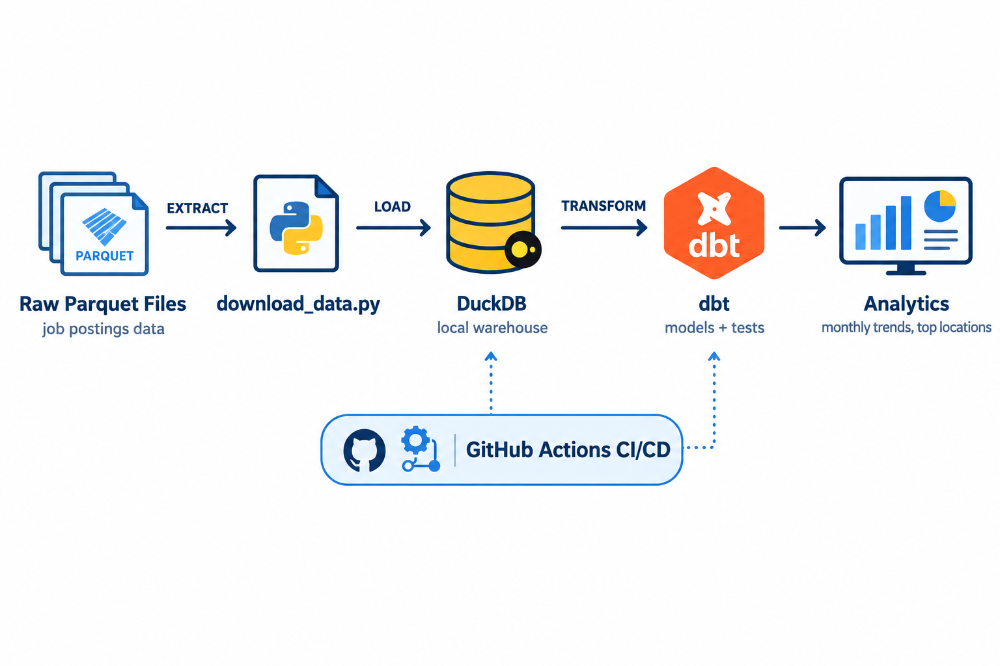
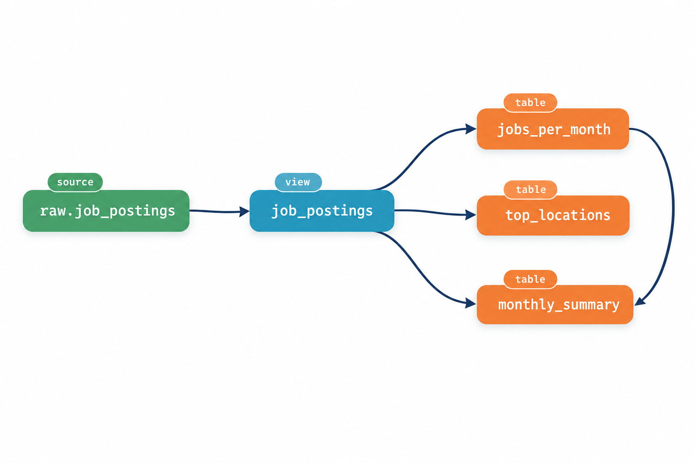
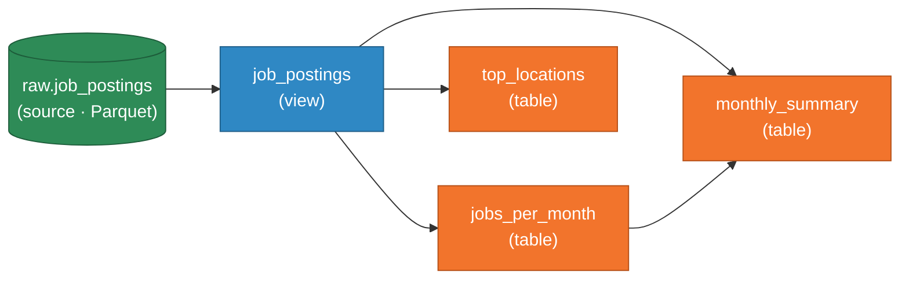

# 📊 dbt Data Pipeline — Job Postings Analytics

[](https://github.com/addosampong/dbt-data-pipeline/actions/workflows/dbt-build.yml)
[](https://docs.getdbt.com/)
[](https://duckdb.org/)
[](https://www.python.org/)
[](https://docs.astral.sh/uv/)

An end-to-end **analytics engineering** project that ingests ~1 year of raw job-postings data (Parquet), loads it into a local **DuckDB** warehouse, and transforms it with **dbt** into tested, documented analytics models — all orchestrated and deployed via **GitHub Actions**.

🔗 **GitHub Repository:** [`GitHub Repo`](https://github.com/addosampong/dbt-data-pipeline) <!-- TODO: replace with repo URL -->
📖 **dbt Docs (GitHub Pages):** [`Pipeline Docs on GitHub Pages`](https://addosampong.github.io/dbt-data-pipeline/) <!-- TODO: replace with GitHub Pages URL -->

---

## 🏗️ Pipeline Architecture

The project follows the **ELT** pattern: raw data is **E**xtracted from a public dataset release, **L**oaded as-is into DuckDB, and **T**ransformed in-warehouse by dbt.



| Stage | Tool | What happens |
|-------|------|--------------|
| **Extract** | [`scripts/download_data.py`](scripts/download_data.py) | Downloads 12 monthly `raw_job_postings_*.parquet` files (+ `raw_job_skills.parquet`, ~85 MB) into `data/raw/` |
| **Load** | DuckDB external source | dbt reads the Parquet files directly via `read_parquet('../data/raw/raw_job_postings_*.parquet')` — no separate loader needed |
| **Transform** | dbt | Cleans the raw feed into a staging view, then builds aggregate mart tables with tests and documentation |
| **Deploy** | GitHub Actions | On every push/PR to `main` (and weekly on a cron), `dbt build` runs and the resulting `prod.duckdb` warehouse is published as a GitHub release asset |

## 🔀 dbt DAG

Model lineage as rendered by `dbt docs` — one cleaned staging view fanning out into three analytics marts:





### Models

| Model | Materialization | Description |
|-------|-----------------|-------------|
| [`job_postings`](analytics/models/job_postings.sql) | view | Cleaned staging layer over the raw source — selects core posting fields and filters out error rows |
| [`jobs_per_month`](analytics/models/jobs_per_month.sql) | table | Posting counts per month and role (search term) |
| [`top_locations`](analytics/models/top_locations.sql) | table | Top 10 job locations by posting volume |
| [`monthly_summary`](analytics/models/monthly_summary.sql) | table | Monthly totals, remote-posting counts, and % remote |

**Data quality** is enforced with dbt tests defined in [`schema.yml`](analytics/models/schema.yml):
`not_null` on `job_postings.job_title`, and `not_null` + `unique` on `monthly_summary.month`. Column-level docs are persisted into the warehouse via `persist_docs`.

## 📁 Project Structure

```text
dbt-data-pipeline/
├── analytics/                 # dbt project
│   ├── dbt_project.yml        # project config (tables by default)
│   └── models/
│       ├── sources.yml        # raw source → external Parquet location
│       ├── schema.yml         # model docs + data tests
│       ├── job_postings.sql   # staging view
│       ├── jobs_per_month.sql # mart
│       ├── top_locations.sql  # mart
│       └── monthly_summary.sql# mart
├── ci/
│   └── profiles.yml           # CI profile → data/prod.duckdb
├── data/                      # gitignored — recreated locally / in CI
│   ├── raw/                   # downloaded Parquet files
│   ├── dev.duckdb             # local dev warehouse
│   └── prod.duckdb            # prod warehouse (built in CI)
├── docs/                      # static dbt docs site (GitHub Pages) + README images
├── scripts/
│   └── download_data.py       # dataset downloader (Extract step)
├── .github/workflows/
│   └── dbt-build.yml          # CI/CD: build, test, publish warehouse
└── pyproject.toml             # Python deps (dbt, sqlfluff, ruff) via uv
```

## 🚀 Getting Started

### Prerequisites

- Python **3.13+**
- [uv](https://docs.astral.sh/uv/) package manager

### 1. Install dependencies

```bash
uv sync
```

### 2. Download the raw data (run once, from the repo root)

```bash
uv run scripts/download_data.py
```

### 3. Build the dbt project

```bash
cd analytics
uv run dbt build
```

`dbt build` runs all models **and** their data tests in dependency order.

### 4. Explore the docs

For a local, live docs server (interactive lineage graph + column-level documentation):

```bash
uv run dbt docs serve   # serves at http://127.0.0.1:8580
```

To regenerate the **static** docs site published to GitHub Pages (written to the repo-root `docs/` folder):

```bash
uv run dbt docs generate --output-dir ../docs
```

The hosted dbt documentation lives on **GitHub Pages**: [`<GITHUB_PAGES_DOCS_URL>`](<GITHUB_PAGES_DOCS_URL>) <!-- TODO: replace with GitHub Pages URL -->

### Querying the warehouse

```sql
-- e.g. with the DuckDB CLI: duckdb data/dev.duckdb
SELECT * FROM monthly_summary ORDER BY month;
SELECT * FROM top_locations;
```

## ⚙️ CI/CD

The [`dbt-build`](.github/workflows/dbt-build.yml) workflow runs on pushes and PRs to `main`, on a weekly schedule, and on demand:

1. **Setup** — checkout + install dependencies with `uv sync`
2. **Extract** — `uv run python scripts/download_data.py`
3. **Build & test** — `uv run dbt build --profiles-dir ../ci` against the `prod` target
4. **Publish** — upload the freshly built `data/prod.duckdb` to the `warehouse` GitHub release

This means the latest tested warehouse is always downloadable as a release artifact — a lightweight "deployment" of the pipeline's output.

## 🛠️ Tech Stack

| Tool | Role |
|------|------|
| [dbt](https://docs.getdbt.com/) | Transformation, testing, documentation |
| [DuckDB](https://duckdb.org/) | Embedded analytical warehouse (via `dbt-duckdb`) |
| [uv](https://docs.astral.sh/uv/) | Python environment & dependency management |
| [SQLFluff](https://sqlfluff.com/) | SQL linting |
| [Ruff](https://docs.astral.sh/ruff/) | Python linting |
| [GitHub Actions](https://docs.github.com/actions) | CI/CD orchestration |

## 🙏 Acknowledgements

Dataset and project structure based on [Luke Barousse's dbt Analytics Engineering Course](https://github.com/lukebarousse/dbt_Analytics_Engineering_Course).
